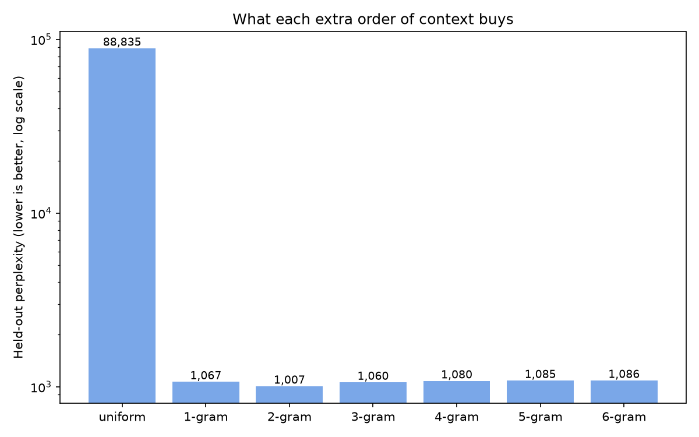

# Benchmark

Complete protocol, results and caveats for the CPU-Native Lookup LLM. For the project overview see [README.md](README.md).

## Contents
1. [Summary](#summary)
2. [Protocol](#protocol)
3. [Metrics](#metrics)
4. [Models compared](#models-compared)
5. [Results](#results)
6. [Generation rule statistics](#generation-rule-statistics)
7. [KenLM details](#kenlm-details)
8. [GPT-2 reference](#gpt-2-reference)
9. [Size and training cost](#size-and-training-cost)
10. [Reproducing the results](#reproducing-the-results)
11. [Run history and reproducibility notes](#run-history-and-reproducibility-notes)
12. [Limitations of this benchmark](#limitations-of-this-benchmark)

---

## Summary

| Model | Held-out perplexity (per token) | Bits per character |
|---|---|---|
| Uniform guess | 88,835 | 3.232 |
| Lookup LLM, simple smoothing (order 6) | 1,086 | 1.983 |
| Lookup LLM, Kneser-Ney (order 4) | 493 | 1.759 |
| KenLM 5-gram (real) | **475** | not measured |
| GPT-2 small (reference) | not comparable (different tokenizer) | **0.998** |

- Kneser-Ney smoothing cut perplexity by 54.6% (1,086 to 493) on the same table, with no retraining.
- With Kneser-Ney, orders 3 to 6 are flat at 493. Context beyond 3 tokens added nothing measurable.
- The table with Kneser-Ney is 3.8% behind real KenLM (493 vs 475).
- GPT-2 small needs about 0.57 as many bits per character as this model (0.998 vs 1.759), and this model's number is optimistic (see [Limitations](#limitations-of-this-benchmark)).



---

## Protocol

**Training data.** The first 5,000 usable documents of `HuggingFaceFW/fineweb-edu` (config `sample-10BT`, streamed, no shuffling). Each document is tokenized and truncated to its first 800 tokens. Documents with fewer than 7 tokens are skipped. This produced 2,589,085 training windows and 10,347,761 indexed contexts.

**Test data.** 200 usable documents taken after skipping the first 6,000 documents of the same stream. The stream order is deterministic, and skipping 6,000 (more than the 5,000 used for training) guarantees there is no overlap even if a few documents were skipped during training. Each test document is truncated to its first 600 tokens.

**Scoring.** For each test document, the first 6 tokens are context only. Every later token is scored given the previous 6 tokens, so every scored token has a full 6-token history available to every order. This gives:

| Quantity | Value |
|---|---|
| Documents | 200 |
| Scored tokens | 87,192 |
| Raw characters covered by the scored tokens | 443,471 |
| Average scored tokens per document | about 436 |

**Tokenizer.** The same regex used in training, applied identically to training and test text:

```
(^[ \t]+|[=<>!+\-*/%&|^~]=|\->|\w+|[^\w\s])
```

The regex keeps words, punctuation, operators and leading indentation, and drops other whitespace. Character offsets are kept so bits per character can be computed over the exact raw text covered by the scored tokens.

**Vocabulary size.** 88,835, estimated as the number of 1-token contexts in the table plus one slot for unseen tokens. It is only used as the floor of the uniform distribution.

---

## Metrics

For `N` scored tokens with model probabilities `p_i`:

- **Bits per token** = `−(1/N) Σ log2 p_i`
- **Perplexity** = `2^(bits per token)` (the effective number of equally likely choices; lower is better)
- **Bits per character** = total bits ÷ raw characters covered (443,471). This is the only metric comparable across different tokenizers.

---

## Models compared

| # | Model | What it is |
|---|---|---|
| 1 | Uniform guess | Every token has probability `1 / 88,835`. The floor. |
| 2 | Lookup LLM, simple smoothing | The `true_lm.db` counts with interpolated **absolute discounting** (discount `D = 0.75` at every order), backing off down to the uniform guess. |
| 3 | Lookup LLM, Kneser-Ney | The same `true_lm.db` counts with **interpolated Kneser-Ney** smoothing, implemented in pure Python (`bench_kn.py`). |
| 4 | KenLM 5-gram | The standard n-gram toolkit (`lmplz -o 5`), trained from scratch on the same 5,000 training documents. |
| 5 | GPT-2 small | A pretrained neural language model, used as a reference point only. |

**Models 2 and 3 read identical counts from the database, so the only difference between them is the smoothing.**

### Simple smoothing (model 2)
For history `h` of length `n` with stored counts `c(h, w)`, total `c(h)` and `N1+(h)` distinct followers:

```
P_n(w|h) = max(c(h,w) − D, 0) / c(h)  +  D · N1+(h) / c(h) · P_(n−1)(w|h')
```

If a context is missing from the table, the model uses the lower-order probability unchanged. The recursion starts from the uniform distribution.

### Kneser-Ney (model 3)
The highest order uses true counts. Every lower order uses **continuation counts** `N1+(• h w)`, the number of distinct tokens that precede the n-gram `(h, w)`. These are collected in one scan of the table (about 18 seconds for 10.3M rows).

- **Discounts** are estimated per order from count-of-counts: `D = n1 / (n1 + 2·n2)`, clipped to `[0.3, 0.95]`, from a deterministic 1-in-20 sample of table rows.
- **Final run discounts**, for history lengths 1 to 6: 0.762, 0.860, 0.940, 0.95 (cap), 0.95 (cap), 0.95 (cap). The highest orders hit the cap, which means most long n-grams were seen exactly once.
- **Differences from KenLM's algorithm:** this implementation uses one discount per order (KenLM uses three, "modified Kneser-Ney"), and it estimates lower-order discounts from true-count statistics. It is the same algorithm family, not the same program.
- **Normalization:** verified numerically. The probabilities sum to 1 over the vocabulary at every order (checked on a stand-in corpus).

---

## Results

### Per order, simple smoothing

| Max order | Perplexity | Bits/token | Bits/char |
|---|---|---|---|
| 0 (uniform) | 88,835.0 | 16.439 | 3.232 |
| 1 | 1,066.7 | 10.059 | 1.978 |
| 2 | **1,007.0** | 9.976 | 1.961 |
| 3 | 1,059.7 | 10.049 | 1.976 |
| 4 | 1,079.9 | 10.077 | 1.981 |
| 5 | 1,085.1 | 10.084 | 1.983 |
| 6 | 1,086.4 | 10.085 | 1.983 |

With simple smoothing, the best order is 2 and every longer context makes the result slightly worse.

### Per order, Kneser-Ney

| Max order | Perplexity | Bits/token | Bits/char |
|---|---|---|---|
| 0 (unigram) | 2,196.8 | 11.101 | 2.183 |
| 1 | 566.8 | 9.147 | 1.798 |
| 2 | 497.2 | 8.958 | 1.761 |
| 3 | **493.0** | 8.945 | 1.759 |
| 4 | 493.0 | 8.945 | 1.759 |
| 5 | 493.1 | 8.946 | 1.759 |
| 6 | 493.0 | 8.945 | 1.759 |

Bits per token for Kneser-Ney are computed as `log2(perplexity)`. With Kneser-Ney, order 3 improves on order 2 by 0.8%, and orders 4 to 6 are within 0.1 of order 3. Treat orders 3 to 6 as tied.

### Derived comparisons

| Comparison | Value |
|---|---|
| Uniform guess vs simple smoothing | 81.8x lower perplexity |
| Simple smoothing vs Kneser-Ney | 2.20x lower perplexity (54.6% reduction) |
| Uniform guess vs Kneser-Ney | 180x lower perplexity |
| Kneser-Ney vs KenLM | KenLM is 3.8% lower (475 vs 493) |
| This model (Kneser-Ney) vs GPT-2 small | 1.76x more bits per character (1.759 vs 0.998) |
| This model (simple smoothing) vs GPT-2 small | 1.99x more bits per character (1.983 vs 0.998) |

---

## Generation rule statistics

These measure the rule the notebook uses to generate text: take the longest context that exists in the table (backoff), keep the top 3 candidates, and sample weighted by score. They are independent of the smoothing used for perplexity.

| Metric | Value |
|---|---|
| Top-1 accuracy (best candidate is the true token) | 15.16% (13,216 of 87,192) |
| Top-3 accuracy (true token is among the 3 candidates) | 22.23% (19,379 of 87,192) |
| Sampled accuracy (chance the weighted sampler picks the true token) | 12.20% |

**Context order the lookup actually used**

| Order used | Share of tokens | Count |
|---|---|---|
| 6-gram | 0.54% | 467 |
| 5-gram | 1.59% | 1,383 |
| 4-gram | 6.53% | 5,697 |
| 3-gram | 21.96% | 19,146 |
| 2-gram | 41.63% | 36,301 |
| 1-gram | 25.32% | 22,079 |
| No match (emits a space) | 2.43% | 2,119 |

The longest context is rarely available: 6-grams and 5-grams together cover 2.1% of tokens, and 2-grams are used most often. This is consistent with the flat Kneser-Ney curve beyond order 3.

---

## KenLM details

Command and data:

```
lmplz -o 5 --discount_fallback < train.txt > kn5.arpa
```

Training text: the same 5,000 FineWeb-Edu documents, first 800 tokens each, one document per line, tokens separated by spaces (spaces and tabs inside tokens escaped as `<sp>` and `<tab>`). Scoring: `kenlm.Model.full_scores(..., bos=True, eos=False)`, summing the log-probabilities of the same scored tokens used for the other models (everything after each document's first 6 tokens).

| | Value |
|---|---|
| Training tokens | 2,619,085 |
| Unigram types | 89,914 |
| 2-grams | 906,100 |
| 3-grams | 1,939,840 |
| 4-grams | 2,402,851 |
| 5-grams | 2,532,872 |
| Total n-grams | 7,871,577 |
| `lmplz` wall time | 5.5 s and 6.2 s (two runs) |
| `lmplz` peak resident memory | about 1.2 GB |
| Held-out perplexity | **475** (identical in both runs) |

KenLM's own memory estimates for the resulting binary model:

| Format | Estimated size |
|---|---|
| Probing | 165 MB |
| Trie | 80 MB |
| Trie, quantized (8-bit) | 43 MB |

Estimated discounts per order (D1 / D2 / D3+): order 2: 0.768 / 1.130 / 1.395; order 3: 0.887 / 1.253 / 1.479; order 4: 0.957 / 1.417 / 1.574; order 5: 0.972 / 1.535 / 1.545.

The training token count (2,619,085) is slightly larger than the lookup model's 2,589,085 windows because KenLM also sees the first 6 tokens of every training document (5,000 × 6 = 30,000).

**KenLM compared with the table:** KenLM's `-o 5` is a 5-gram, meaning 4 tokens of history, so it is compared with the Kneser-Ney **order 4** result (493.0).

---

## GPT-2 reference

GPT-2 small (the pretrained Hugging Face `gpt2` checkpoint) was scored on the same raw text span as the other models: each test document's text from the start of the first scored token to the end of the last scored token, with the earlier text available as context. Its per-token negative log-likelihood was summed over the BPE tokens inside that span and divided by the same 443,471 characters.

| | Value |
|---|---|
| GPT-2 small | 0.998 bits/char |
| Documents skipped for exceeding 1,024 BPE tokens | 0 |

GPT-2 uses a different tokenizer, so its perplexity per token is not comparable and is not reported. It was trained on different, much larger data and sees the whole document as context. It is a **reference point, not a like-for-like competitor.**

---

## Size and training cost

| | Lookup LLM (SQLite) | KenLM 5-gram |
|---|---|---|
| Stored items | 10,347,761 contexts, each holding a JSON dictionary of scores | 7,871,577 n-grams |
| Size | about 1.5 GB | 80 to 165 MB estimated (binary), 43 MB quantized |
| Training time | 4,949.85 s (82.5 minutes) | 5.5 to 6.2 s (`lmplz`) |

Size ratio: about 9x to 19x larger than KenLM's estimated 165 MB to 80 MB. Time ratio: about 800x to 900x. The time comparison covers KenLM's counting and writing only, and the SQLite indexer is single-threaded Python making several database reads and writes per window, so this compares implementations as much as algorithms.

**Training time grows as the table grows** (multi-order run, cumulative):

| Documents | Training windows | Indexed contexts | Cumulative time | Time for this 1,000 docs |
|---|---|---|---|---|
| 1,000 | 525,453 | 2,267,126 | 374.8 s | 374.8 s |
| 2,000 | 1,041,649 | 4,358,055 | 1,103.3 s | 728.5 s |
| 3,000 | 1,550,307 | 6,363,124 | 2,126.6 s | 1,023.3 s |
| 4,000 | 2,075,180 | 8,389,540 | 3,435.4 s | 1,308.8 s |
| 5,000 | 2,589,085 | 10,347,761 | 4,949.9 s | 1,514.5 s |

For comparison, the earlier single-order in-memory Trie trained on 5,000 documents in 27.4 s (3,383,950 tokens, 3,579,681 paths), but it only stored one order and kept everything in RAM.

**Benchmark runtime:** the evaluation itself is quick. The simple-smoothing evaluation took 53 s on Windows. The Kneser-Ney table scan took 18 s and the evaluation 8 s under WSL.

---

## Reproducing the results

### Without KenLM (any OS)
```bash
pip install datasets
python bench_kn.py        # true_lm.db must be in the same folder
```
This prints perplexity for orders 0 to 6 with simple smoothing and Kneser-Ney, and writes `benchmark_kn_results.json`. When the `kenlm` module and `lmplz` are not installed it prints a notice and skips KenLM.

### With real KenLM (WSL / Ubuntu)
```bash
sudo apt update
sudo apt install -y build-essential cmake git python3-dev python3-venv \
  libboost-system-dev libboost-thread-dev libboost-program-options-dev libboost-test-dev \
  libeigen3-dev zlib1g-dev libbz2-dev liblzma-dev

git clone https://github.com/kpu/kenlm ~/kenlm
mkdir -p ~/kenlm/build && cd ~/kenlm/build && cmake .. && make -j4
echo 'export PATH=$HOME/kenlm/build/bin:$PATH' >> ~/.bashrc && source ~/.bashrc

python3 -m venv ~/lmenv && source ~/lmenv/bin/activate
pip install datasets https://github.com/kpu/kenlm/archive/master.zip

mkdir -p ~/work && cd ~/work
cp /path/to/true_lm.db /path/to/bench_kn.py .     # copy to WSL's own disk; SQLite is slow on /mnt/c
python bench_kn.py
```

### Colab
`benchmark_colab.py` contains the same benchmark as Colab cells, including the GPT-2 reference cell and a KenLM cell. Upload `true_lm.db` into `/content` first. Colab wipes uploaded files when the runtime resets.

### Settings that must match training
`MAX_ORDER = 6`, `DEFAULT_SCORE = 10`, `LR = 2`. Test set: `SKIP_DOCS = 6000`, `TEST_DOCS = 200`, `MAX_TOKENS_PER_DOC = 600`.

---

## Run history and reproducibility notes

- The simple-smoothing and GPT-2 numbers were produced on Windows. The Kneser-Ney and KenLM numbers were produced under WSL.
- **Kneser-Ney varied between early runs (493, then 500).** The first version of `bench_kn.py` chose the table rows used to estimate discounts with Python's `hash()`, which is randomized per process, so the discounts changed slightly from run to run. The script now uses a fixed hash (`zlib.crc32`), and the published numbers come from a run with the fixed version (discounts 0.762, 0.860, 0.940, 0.95, 0.95, 0.95; perplexity 493.0).
- A stale `benchmark_kn_results.json` from an early run may still show the old discount-sampling numbers. Re-run `bench_kn.py` to regenerate it.
- KenLM's result (475) was identical across two runs. Only its wall time varied (5.5 s and 6.2 s).

---

## Limitations of this benchmark

- **One test set, one run, no confidence intervals.** 87,192 tokens from 200 documents of one dataset. Differences of a fraction of a percent (for example orders 3 to 6 with Kneser-Ney) are not meaningful.
- **In-domain only.** Training and test text both come from FineWeb-Edu. No other domain, and no code benchmark, was measured, although the tokenizer is code-aware.
- **Bits per character is optimistic for this model.** Its tokenizer drops whitespace, so the model is never charged for predicting spacing. GPT-2 predicts the raw text, including spacing. The true gap to GPT-2 is therefore larger than 1.76x.
- **The GPT-2 comparison is not like-for-like.** Different tokenizer, much more training data, and the whole document as context.
- **KenLM treats unseen words as one `<unk>` token**, which favors it slightly compared with the lookup model, which spreads probability over an 88,835-word floor. KenLM also saw the first 6 tokens of each training document that the table did not index.
- **The Kneser-Ney implementation is simplified.** One discount per order, and lower-order discounts estimated from true-count statistics. Modified Kneser-Ney (three discounts) would likely narrow the remaining 3.8% gap, but this has not been tested.
- **Discounts at the highest orders hit the 0.95 cap.** A different cap could change the high-order results slightly.
- **Perplexity measures the probability model, not the generator.** The notebook's text generator still uses "first hit wins, top-3 weighted sampling", so the Kneser-Ney gains do not automatically improve generated text.
- **Context-key ambiguity.** Contexts are stored as tokens joined with `||`. Tokens containing `|` could in rare cases make two different contexts produce similar keys. This affects a negligible fraction of rows.
- **Vocabulary size is estimated** (88,835 from the table, against KenLM's 89,914 types). It only affects the probability floor for unseen tokens.
- **No neural model trained on the same 2.6M tokens.** That would be the only fully fair neural comparison and is listed as future work.
