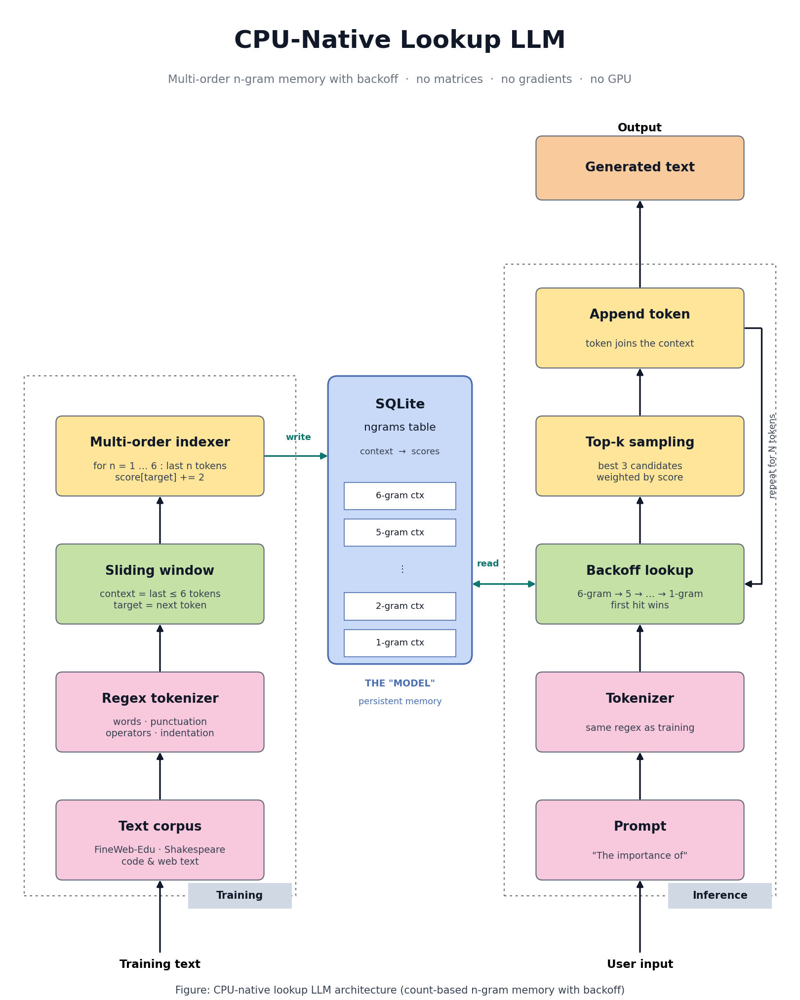

# CPU-Native Lookup LLM

A tiny language model that trains and runs on a CPU with **no matrices, no gradients and no GPU**.

Instead of billions of weights, the "model" is a **SQLite table** that maps token contexts to next-token scores. Generation is a database lookup with backoff, repeated one token at a time.

> **Honest framing:** this is a count-based, multi-order **n-gram language model with backoff**, stored in SQLite. It is not a transformer replacement. It is an experiment in how far cheap lookup memory can go, and where it breaks.



---

## How it works

### Training (one pass over text)
1. **Tokenize** text with a regex (words, punctuation, operators, indentation).
2. **Slide a window** over the tokens: the last up to 6 tokens are the *context*, the next token is the *target*.
3. **Index every sub-context** (the last 1, 2, … 6 tokens) and add `+2` to the target's score. A target seen for the first time starts at a default score of `10`.
4. Write the scores to SQLite (`context` primary key, `scores` as JSON).

### Inference (autoregressive loop)
1. Tokenize the prompt with the same regex.
2. **Backoff lookup:** try the 6-token context first, then 5, 4, … down to 1. The first context that has scores wins.
3. **Top-k sampling:** keep the best 3 candidates and sample, weighted by score.
4. Append the token to the context and repeat.

Lookup cost depends on the context window size, not on the size of the corpus.

---

## Evolution of the notebook

The notebook shows the idea growing step by step:

| Stage | What changed |
|---|---|
| 1 | Dictionary lookup table with reward-based score updates |
| 2 | Trie for O(K) context lookup |
| 3 | Persistence to disk, plus beam-style generation |
| 4 | Tiny Shakespeare: 303K tokens trained in about 2 seconds |
| 5 | Streaming FineWeb-Edu training |
| 6 | Code-aware tokenizer and SQLite storage |
| 7 | Backoff (6-gram down to 1-gram) |
| 8 | Multi-order indexing and an interactive prompt shell |

---

## Results

| Experiment | Result |
|---|---|
| Tiny Shakespeare (302,927 tokens) | Trained in about 2 seconds |
| FineWeb-Edu, 5,000 docs (single-order Trie) | 3.4M tokens, 3.58M paths, about 27 seconds |
| FineWeb-Edu, multi-order, 5,000 docs | 2.59M tokens, **10.35M indexed paths**, about 82 minutes |
| Final database (`true_lm.db`) | **About 1.5 GB** |

Example generations from the final model:

```
Prompt > The importance of
The importance of the inner planets. Next, we need to do their job, and together
they put in a vaccine. Mice were given three injections of empty virus alone ...

Prompt > what is air
what is air pushing air. There are therefore several sound coup ...
```

Locally the text looks fluent. Globally it drifts off-topic.

---

## The harsh truth

- **Size explodes.** About 2.6M training tokens produced a **1.5 GB** database, roughly 580 bytes of storage per training token. Indexing every sub-context multiplies the rows.
- **Training slows down.** Multi-order indexing made 5,000 documents take about 82 minutes, versus about 27 seconds for single-order. Each token costs several SQLite read-and-write round trips.
- **No long-range understanding.** Context is capped at 6 tokens, so the model cannot track a topic, argument or instruction.
- **No generalization.** It can only retrieve patterns it has seen. Unseen contexts fall back to shorter n-grams, and eventually to a single-token guess.
- **Not a reasoning model.** It does not follow instructions, answer questions or do multi-step logic.

---

## What it is good for

- Offline or on-device autocomplete and code completion
- Fully interpretable next-token predictions (query the table and see why)
- Incremental learning: new data just updates rows, with no retraining
- A teaching tool for understanding language modeling without deep learning

---

## Quick start

```bash
pip install datasets
jupyter notebook
```

1. Open the notebook and run the cells in order.
2. Run the multi-order training cell to build `true_lm.db`. It streams data from Hugging Face (`HuggingFaceFW/fineweb-edu`, `sample-10BT`), so it needs internet and takes a while.
3. Run the interactive shell cell and type a prompt:

```
Prompt > for i in range (
```

> `true_lm.db` is about 1.5 GB, so it is not stored in git (GitHub blocks files over 100 MB). Rebuild it with the training cell, or host it externally and download it into the notebook folder.

---

## Ideas for improvement

- **Prune** low-count paths to shrink the database
- **Batch writes** or keep counts in memory before flushing to SQLite
- **Smoothing**: proper backoff such as stupid backoff or Kneser-Ney instead of "first hit wins"
- **Compact storage**: hashed contexts, integer token IDs, binary-packed scores
- **Hybrid model**: use the lookup memory for cheap, frequent cases and a small neural model for hard ones
- **Real evaluation**: perplexity on a held-out set

---

## Disclaimer

This is an experimental project. It is not production software and makes no claim to outperform neural language models.

## License

Add your preferred license here (for example MIT).
