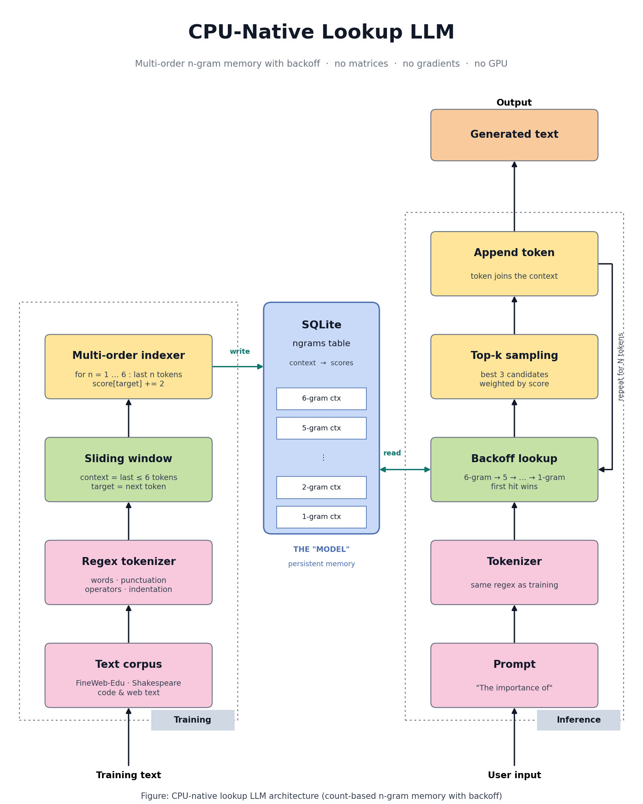
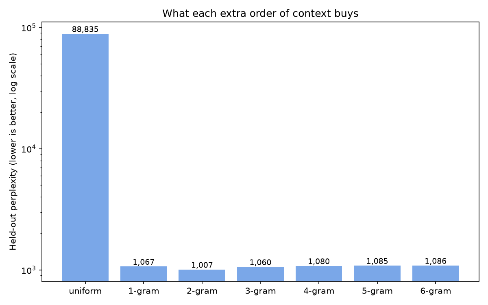

# CPU-Native Lookup LLM

A small language model that trains and runs on a CPU with **no matrices, no gradients and no GPU**.

Instead of billions of weights, the "model" is a **SQLite table** that maps token contexts to next-token scores. Generating text is a database lookup with backoff, repeated one token at a time.

> **Honest framing:** this is a count-based, multi-order **n-gram language model with backoff**, stored in SQLite. It is not a transformer replacement. It is an experiment in how far cheap lookup memory can go, and where it breaks. The full measurements are in [BENCHMARK.md](BENCHMARK.md).



---

## Results at a glance

| | Result |
|---|---|
| Training data | 5,000 FineWeb-Edu documents (first 800 tokens each) |
| Training windows processed | 2,589,085 |
| Database (`true_lm.db`) | about 1.5 GB, 10,347,761 indexed contexts |
| Training time | 4,949.85 s (about 82.5 minutes) on CPU |
| Held-out perplexity, simple smoothing | 1,086 |
| Held-out perplexity, Kneser-Ney smoothing | **493** |
| Real KenLM 5-gram (same training data) | **475** (3.8% better than this model) |
| Random guess (uniform) | 88,835 |
| GPT-2 small, bits per character | 0.998 (this model with Kneser-Ney: 1.759) |
| Next-token accuracy (generation rule) | top-1 15.2%, top-3 22.2% |

Lower perplexity is better. All held-out numbers are measured on 87,192 tokens of text the model never saw. Full tables, protocol and caveats are in [BENCHMARK.md](BENCHMARK.md).

**Three findings**
1. **Smoothing mattered more than context length.** Swapping simple smoothing for Kneser-Ney cut perplexity by 54.6% (1,086 to 493) with no retraining.
2. **Context beyond 3 tokens added nothing measurable.** The 6-token context was found for only 0.54% of test tokens.
3. **The storage format is the inefficient part.** KenLM estimates 80 to 165 MB for a 5-gram model on the same data and trains in about 6 seconds. This SQLite table is about 1.5 GB and took 82 minutes.

---

## How it works

### Storage format
One SQLite table:

```sql
CREATE TABLE ngrams (
    context TEXT PRIMARY KEY,   -- tokens joined with "||", for example  the||importance||of
    scores  TEXT                -- JSON, for example  {"the": 18, "our": 14}
);
```

A score is `10 + 2 × count` (a new target starts at 10, every observation adds 2), so the raw count is `(score − 10) / 2`.

### Training (one pass over text)
1. **Tokenize** with a regex (words, punctuation, operators, indentation): `(^[ \t]+|[=<>!+\-*/%&|^~]=|\->|\w+|[^\w\s])`.
2. **Slide a window** over each document's first 800 tokens: the 6 tokens form the *context*, the next token is the *target*.
3. **Index every sub-context.** For sizes 1 to 6, take the last `n` tokens as the key and add 2 to the target's score.
4. Write the updated scores to SQLite.

### Inference (autoregressive loop)
1. Tokenize the prompt with the same regex.
2. **Backoff lookup:** try the 6-token context, then 5, 4, … down to 1. The first context that has scores wins. If nothing matches, emit a space.
3. **Top-k sampling:** keep the 3 highest-scoring candidates and sample, weighted by score.
4. Append the token to the context and repeat.

Lookup cost depends on the context window size, not on the size of the corpus.

### Hyperparameters

| Setting | Value |
|---|---|
| Max context window | 6 tokens |
| Default score for a new target | 10 |
| Score increment per observation (`lr`) | 2 |
| Sampling candidates (`beam_width`) | 3 |
| Tokens generated per prompt | 40 |

---

## Development history (from the notebook)

| Stage | What was built | Logged result |
|---|---|---|
| 1 | Dictionary lookup table with reward-based score updates | Toy example |
| 2 | Trie for fast context lookup | Toy example |
| 3 | Save and load the model to disk (`cpu_coder_model.bin`) | Toy example |
| 4 | Tiny Shakespeare | 302,927 tokens trained in 1.96 s |
| 5 | FineWeb-Edu streaming, single-order Trie, 5,000 docs | 3,383,950 tokens, 3,579,681 paths, 27.4 s |
| 6 | Code-aware tokenizer, 3,000 docs | 1,718,772 tokens, 5,317,343 paths, 38.3 s |
| 7 | Backoff-enabled Trie | 3,674,325 paths |
| 8 | Scale-up: in-memory Trie to 10,000 docs, then disk-backed SQLite | 23,465,689 paths in memory (109.9 s); SQLite run reached 19,000 docs |
| 9 | **Multi-order SQLite model (`true_lm.db`)**, 5,000 docs | 2,589,085 windows, 10,347,761 contexts, 4,949.85 s |

Each stage counts tokens its own way (stage 9 truncates every document to 800 tokens), so token counts across stages are not directly comparable.

---

## Held-out benchmark (summary)

Test set: 200 FineWeb-Edu documents the model never saw. 87,192 scored tokens, 443,471 characters.

| Max context order | Simple smoothing (perplexity) | Kneser-Ney (perplexity) |
|---|---|---|
| 0 | 88,835 (uniform guess) | 2,197 (unigram) |
| 1 | 1,067 | 567 |
| 2 | 1,007 | 497 |
| 3 | 1,060 | **493** |
| 4 | 1,080 | 493 |
| 5 | 1,085 | 493 |
| 6 (full model) | 1,086 | 493 |

| Model | Held-out perplexity (per token) |
|---|---|
| Uniform guess | 88,835 |
| This model, simple smoothing (order 6) | 1,086 |
| This model, Kneser-Ney (order 4) | 493 |
| KenLM 5-gram | **475** |

| Reference | Bits per character |
|---|---|
| GPT-2 small | 0.998 |
| This model, Kneser-Ney | 1.759 |
| This model, simple smoothing | 1.983 |



| | This model (SQLite) | KenLM 5-gram |
|---|---|---|
| Size | about 1.5 GB | about 80 to 165 MB (KenLM's estimate for its binary format) |
| Training | about 82.5 minutes | about 6 seconds (`lmplz`) |

Details, protocol, KenLM statistics and every caveat are in **[BENCHMARK.md](BENCHMARK.md)**.

---

## Example generations (final `true_lm.db` model)

These are real outputs from the final multi-order model (spacing after punctuation tidied, because the notebook's output joiner only inserts spaces between two alphanumeric tokens).

> **Prompt:** The importance of
> **Output:** The importance of training in the field of human genetics counseling is demonstrated by the success of the Sarah Lawrence graduates. Genetics programs at major teaching hospitals, other colleges and universities

> **Prompt:** In order to
> **Output:** In order to make hydrogen a viable alternative to petrol, a material which can store hydrogen at a weight of over six per cent is required. This figure is estimated by

> **Prompt:** Python is a
> **Output:** Python is a good idea. Be aware, though, that you need to know what you are allowed to make rubbings of; it is illegal some places to make rubbings

The text is locally fluent and globally drifts: the last example starts about Python and ends up on rubbings.

---

## Limitations

- **Storage explodes.** About 2.6M training windows produced a 1.5 GB database, roughly 580 bytes per window, because every sub-context is stored.
- **Training slows as the table grows.** The multi-order run took 374 s for the first 1,000 documents and 1,514 s for the last 1,000, because each update is several SQLite reads and writes.
- **No long-range understanding.** Context is capped at 6 tokens, so the model cannot follow a topic, an argument or an instruction.
- **No generalization.** It only retrieves patterns it has seen. Unseen contexts back off to shorter ones.
- **A standard tool is far more compact.** KenLM covers the same data in an estimated 80 to 165 MB and trains in seconds.
- **The generator does not use Kneser-Ney yet.** The Kneser-Ney gains apply to probability estimates in the benchmark. The notebook's generator still uses "first hit wins, top-3 sampling".
- **Code completion was weak.** Earlier code-completion experiments in the notebook often degenerated into repeated newlines.
- **Not a reasoning model.** It does not follow instructions, answer questions or do multi-step logic.

---

## What it is good for

- Offline or on-device autocomplete experiments
- Fully interpretable next-token predictions (query the table and see why)
- Incremental learning: new data just updates rows, with no retraining
- A teaching tool for language modeling without deep learning

---

## Repository contents

| File | Purpose |
|---|---|
| `Untitled254.ipynb` | The notebook: every stage from toy dictionary to `true_lm.db` (rename as you like) |
| `README.md` | This file |
| `BENCHMARK.md` | Full benchmark protocol, tables, caveats and reproduction steps |
| `bench_kn.py` | Held-out evaluation: simple smoothing, Kneser-Ney, and real KenLM when available |
| `benchmark_colab.py` | Colab version of the benchmark, including the GPT-2 reference cell |
| `benchmark_kn_results.json` | Raw output of `bench_kn.py` |
| `perplexity_by_order.png` | Perplexity by context order |
| `cpu_lookup_llm_architecture.png` | Architecture diagram |
| `LICENSE` | MIT License |

`true_lm.db` (about 1.5 GB) is not stored in git, because GitHub blocks files over 100 MB. Rebuild it by running the multi-order training cell, or host it elsewhere and download it into the repo folder.

---

## Quick start

```bash
pip install datasets
jupyter notebook
```

1. Open the notebook and run the cells in order.
2. Run the multi-order training cell to build `true_lm.db`. It streams `HuggingFaceFW/fineweb-edu` (`sample-10BT`), so it needs internet, and it took about 82 minutes on CPU for 5,000 documents.
3. Run the interactive shell cell and type a prompt:

```
Prompt > what is air
```

To reproduce the benchmark, put `true_lm.db` next to `bench_kn.py` and run:

```bash
python bench_kn.py
```

Real KenLM runs automatically if the `kenlm` Python module and the `lmplz` binary are installed (Linux, WSL or Colab), and is skipped otherwise. Setup steps are in [BENCHMARK.md](BENCHMARK.md#reproducing-the-results).

---

## Ideas for improvement

- **Prune** orders 4 to 6 and low-count contexts: they add no measurable accuracy in the benchmark, so the database can likely shrink a lot
- **Use Kneser-Ney probabilities in the generator** instead of "first hit wins"
- **Batch writes** or keep counts in memory before flushing to SQLite
- **Compact storage**: integer token IDs, hashed contexts, binary-packed counts
- **Modified Kneser-Ney** (three discounts per order, as KenLM uses) to close the remaining gap
- **Hybrid model**: use the lookup memory for cheap, frequent cases and a small neural model for hard ones
- **Fair neural baseline**: train a tiny transformer on the same 2.6M tokens (GPT-2 saw far more data)

---

## Acknowledgements

Thanks to Rohan Ganesh, who suggested benchmarking against standard baselines (which led to [BENCHMARK.md](BENCHMARK.md)), and to Mohammed Salman for feedback along the way.

## Disclaimer

This is an experimental project. It is not production software and makes no claim to outperform neural language models.

## License

Released under the MIT License. See the [LICENSE](LICENSE) file for details.
